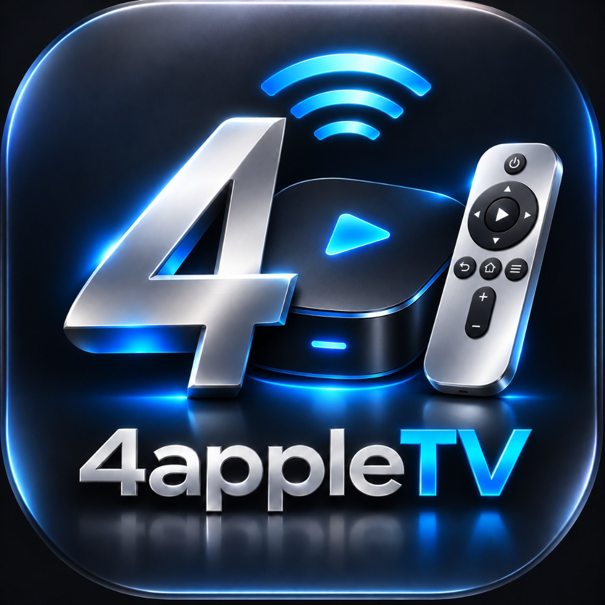

<div align="center">
  
  <h1>4AppleTV Lite</h1>
  <p><strong>Phiên bản công khai miễn phí (Không cần mã kích hoạt) dành cho iPhone / iPad</strong><br />
  Quản lý Apple TV qua Wi-Fi với <strong>Remote đầy đủ</strong>, <strong>Chụp màn hình TV không dây</strong> và <strong>Kho ứng dụng (Library) đầy đủ</strong> — 100% ứng dụng tvOS cài &amp; chạy qua <strong><code>LiveContainerTV</code></strong>.</p>

  <p><em>Free public edition of 4AppleTV — Zero activation key required, 1 Primary Apple ID, Full Apple TV Remote, Wireless Screenshots, and Full App Library running 100% inside <code>LiveContainerTV</code>.</em></p>

  <p>
    <a href="https://github.com/hongson117/4AppleTV/raw/lite/4AppleTV-Lite.ipa">
      
    </a>
    <a href="https://raw.githubusercontent.com/hongson117/4AppleTV/lite/source.json">
      
    </a>
    <a href="https://github.com/hongson117/InfinitySideload-releases">
      
    </a>
    <a href="https://github.com/hongson117/4AppleTV/tree/main">
      
    </a>
  </p>
</div>

---

## 📥 Tải Trực Tiếp & Nguồn Cài Đặt Công Khai

| Thành phần | Đường dẫn chính thức |
| :--- | :--- |
| **Tải trực tiếp file `.ipa` (`HTTPS`)** | [**⬇️ `4AppleTV-Lite.ipa`**](https://github.com/hongson117/4AppleTV/raw/lite/4AppleTV-Lite.ipa) · `https://github.com/hongson117/4AppleTV/raw/lite/4AppleTV-Lite.ipa` |
| **Nguồn Repo (`AltStore` / `SideStore` / `Feather` / `∞Sideload`)** | `https://raw.githubusercontent.com/hongson117/4AppleTV/lite/source.json` |
| **Kiểm tra phiên bản & toàn vẹn SHA-256** | [`version.json`](https://raw.githubusercontent.com/hongson117/4AppleTV/lite/version.json) · [`SHA256SUMS.txt`](https://raw.githubusercontent.com/hongson117/4AppleTV/lite/SHA256SUMS.txt) |
| **Trang nhánh công khai (`lite`)** | https://github.com/hongson117/4AppleTV/tree/lite |
| **Trình cài đặt iOS 17.4+ khuyên dùng (`∞Sideload`)** | https://github.com/hongson117/InfinitySideload-releases |
| **Phiên bản Đầy đủ / Pro (`main`)** | https://github.com/hongson117/4AppleTV/tree/main |

---

## ⚡ 1. Đặc Điểm & Nguyên Tắc Cốt Lõi Của 4AppleTV Lite

> [!IMPORTANT]
> **QUY TẮC BẮT BUỘC TRƯỚC KHI CÀI BẤT KỲ ỨNG DỤNG NÀO:**  
> Trên **4AppleTV Lite**, bạn **BẮT BUỘC phải cài đặt và khởi chạy `LiveContainerTV` ĐẦU TIÊN** trên Apple TV trước khi cài Kodi, Stremio, Orivio TV, Nuvio TV, Yattee hay bất kỳ file `.ipa` / `.deb` nào khác.  
> **Lý do:** Bản Lite **tắt hoàn toàn việc cài trực tiếp từng app riêng lẻ ra màn hình chính tvOS**, giúp 1 tài khoản Apple ID miễn phí chỉ tiêu tốn **duy nhất 1 slot App ID cho `LiveContainerTV`**, từ đó cài và chạy **không giới hạn số lượng ứng dụng tvOS** bên trong `LiveContainerTV` mà không bị lỗi hết 3 slot App ID của Apple.

| Tính năng | 4AppleTV Lite (`lite`) | 4AppleTV Full / Pro (`main`) |
| :--- | :--- | :--- |
| **Mã kích hoạt / License Server** | **Miễn phí hoàn toàn — Không cần mã** | Cần mã kích hoạt (Sideload Pass) |
| **Tài khoản Apple ID** | **Tối đa 1 Apple ID chính (`1/1`)** | Đa tài khoản Apple ID (tối đa 3) |
| **Chứng chỉ ngoài (`.p12` / `.mobileprovision`)** | **Đã tắt** | Hỗ trợ đầy đủ |
| **Cài trực tiếp ra màn hình chính tvOS** | **Đã tắt — Ép buộc 100% qua `LiveContainerTV`** | Hỗ trợ cả cài trực tiếp & `LiveContainerTV` |
| **Thanh điều hướng (Tabs)** | **4 tab gọn nhẹ**: `Điều khiển (Remote)`, `LiveContainer`, `Tài khoản (Account)`, `Thiết bị (Devices)` *(đã bỏ tab `TV Apps`)* | 5 tab đầy đủ (có tab `TV Apps`) |
| **Apple TV Remote (`D-pad` / `Touchpad` / Bàn phím Tiếng Việt / Âm lượng)** | **Đầy đủ** | Đầy đủ |
| **Chụp màn hình Apple TV không dây (`1080p`/`4K`)** | **Đầy đủ** (lưu trong Kho ảnh TV & Tệp) | Đầy đủ |
| **Kho ứng dụng (`Library`) + 8 định dạng nguồn + tự đổi `.deb → .ipa` + Gói 4 app + GitHub PAT** | **Đầy đủ** | Đầy đủ |
| **Gia hạn nhanh 7 ngày (`misagent`) & tự nối lại khi mất pair** | **Đầy đủ** | Đầy đủ |

---

## 📖 2. Hướng Dẫn Sử Dụng Chi Tiết Từ A – Z (Tiếng Việt)

Ứng dụng hỗ trợ chuyển đổi trực tiếp **Tiếng Việt / English / Theo hệ thống** qua biểu tượng quả cầu **🌐** ở thanh công cụ hoặc mục **Cài đặt (`Settings`) → Ngôn ngữ (`Language`)**.

### Bước 1: Cài đặt `4AppleTV-Lite.ipa` lên iPhone / iPad (`iOS / iPadOS 17.0+`)
1. Tải trực tiếp [`4AppleTV-Lite.ipa`](https://github.com/hongson117/4AppleTV/raw/lite/4AppleTV-Lite.ipa) hoặc dán URL nguồn Repo `https://raw.githubusercontent.com/hongson117/4AppleTV/lite/source.json` vào công cụ cài đặt iOS bạn đang dùng:
   - **iOS/iPadOS 17.4+ khuyên dùng:** **[∞Sideload (InfinitySideload)](https://github.com/hongson117/InfinitySideload-releases)**, **SideStore** hoặc **AltStore** *(dán URL `source.json` ở trên vào mục **Sources** để tiện cập nhật bản mới)*.
   - **Nếu có chứng chỉ `.p12` cá nhân trên iPhone:** Mở **Feather**, **ESign**, **GBox** hoặc **Scarlet** → Nhập file `4AppleTV-Lite.ipa` → Bấm **Ký (`Sign`)** & **Cài đặt (`Install`)**.
   - **Khác:** Dùng **TrollStore** hoặc **Sideloadly** trên máy tính.
2. Khi mở app lần đầu, iOS sẽ hỏi quyền **Mạng cục bộ (`Local Network`)** → **Bắt buộc bấm Cho phép (`Allow`)**.
3. Đảm bảo **iPhone/iPad và Apple TV đang kết nối cùng một mạng Wi-Fi / LAN** và **tắt VPN** *(nếu đang bật VPN chặn LAN, iPhone sẽ không nhìn thấy Apple TV)*. Bản Lite **không yêu cầu nhập mã kích hoạt**.

---

### Bước 2: Ghép đôi Apple TV & Bật Developer Mode (Làm 1 lần duy nhất)

#### 2.1. Ghép đôi Điều khiển từ xa (`Remote Pairing` — Mã PIN 4 chữ số)
1. Trên màn hình Apple TV, mở: **`Settings` → `Remotes and Devices` → `Remote App and Devices`**.
2. Trên iPhone, mở `4AppleTV Lite` → vào tab **`Điều khiển` (`Remote`)** hoặc **`Thiết bị` (`Devices`)** → chọn tên Apple TV của bạn → nhập **mã PIN 4 chữ số** hiển thị trên màn hình TV.

#### 2.2. Ghép đôi Cài đặt Ứng dụng (`Sideload Pairing` — Mã PIN 6 chữ số)
1. Giữ Apple TV ở màn hình **`Settings` → `Remotes and Devices` → `Remote App and Devices`**.
2. Trên iPhone, vào tab **`Thiết bị` (`Devices`)** → bấm nút **`+` (Ghép đôi mới / Pair New TV)** → chọn Apple TV → nhập **mã PIN 6 chữ số** hiện trên màn hình TV để lưu hồ sơ cài app & UDID của Apple TV.

#### 2.3. Bật `Developer Mode` trên Apple TV (`tvOS 16+`)
1. Trên Apple TV, vào: **`Settings` → `Privacy and Security` → `Developer Mode`**.
2. Bật **ON** → Apple TV sẽ khởi động lại → Sau khi TV khởi động xong, chọn **`Turn On`** trên hộp thoại xác nhận hiện ra.
> *Lưu ý: Nếu chưa thấy mục `Developer Mode` trong phần Privacy and Security trên tvOS, hãy hoàn tất bước **2.2 (Sideload Pairing)** trước hoặc cài thử lần đầu để menu `Developer Mode` tự xuất hiện.*

---

### Bước 3: Đăng nhập 1 Tài khoản Apple ID chính (Tab `Tài khoản` / `Account`)
1. Mở tab **`Tài khoản` (`Account`)** trên iPhone.
2. Bấm đăng nhập **Apple ID** và nhập email + mật khẩu Apple ID của bạn *(tài khoản Apple ID miễn phí thông thường dùng hoàn toàn bình thường; nhập mã xác thực 2FA 6 chữ số nếu Apple gửi về máy)*.
3. **Lưu ý giới hạn Lite:** Phiên bản Lite chỉ lưu **1 tài khoản Apple ID chính duy nhất (`1/1`)** và không sử dụng chứng chỉ `.p12`. Không cần nhập bất kỳ mã bản quyền nào.

---

### Bước 4 (BẮT BUỘC LÀM TRƯỚC NHẤT): Cài đặt & Khởi chạy `LiveContainerTV` đầu tiên

> [!WARNING]
> **HÃY LÀM BƯỚC NÀY TRƯỚC KHI CÀI BẤT KỲ ỨNG DỤNG NÀO KHÁC!**  
> Nếu bạn chọn cài Kodi, Stremio, Orivio hay file `.ipa`/`.deb` khác trước khi `LiveContainerTV` được cài và mở lên trên Apple TV, quá trình cài đặt ứng dụng con sẽ không có container đích để nạp vào.

1. Mở tab **`LiveContainer`** trên `4AppleTV Lite`, giữ ở phân mục **`Đã cài đặt` (`Installed`)**.
2. **Chọn một trong hai cách để cài `LiveContainerTV`:**
   - **Cách 1 (Khuyên dùng — 1 chạm):** Ngay tại thẻ **`LiveContainerTV · <Tên Apple TV>`** *(đang hiện nhãn `Chưa cài` / `Not Installed`)*, bấm nút **`Khởi tạo LiveContainerTV` (`Set Up LiveContainerTV`)** → ứng dụng sẽ tự động tải gói `LiveContainerTV` chính thức, ký bằng Apple ID chính của bạn và cài không dây lên màn hình chính Apple TV.
   - **Cách 2:** Chuyển sang phân mục **`Thư viện` (`Library`)** ngay trong tab `LiveContainer` → chạm **`LiveContainerTV`** → bấm tải và cài đặt lên Apple TV.
3. **Mở `LiveContainerTV` trên Apple TV để kích hoạt cổng kết nối lần đầu (RẤT QUAN TRỌNG):**
   - Dùng điều khiển mở biểu tượng **`LiveContainerTV`** vừa xuất hiện trên màn hình chính Apple TV *(nếu TV hỏi quyền truy cập mạng nội bộ, bấm **Allow**)*.
   - Quay lại iPhone tại tab **`LiveContainer`**, bấm nút **`Đồng bộ` (`Sync`)** (hoặc kéo xuống để làm mới). Khi thẻ trạng thái chuyển từ **`Đang nghỉ` (`Standby`)** sang huy hiệu xanh lá **`Trực tuyến :8228` (`Online :8228`)**, Apple TV đã sẵn sàng nhận không giới hạn ứng dụng con!

---

### Bước 5: Cài đặt các ứng dụng khác (Kodi, Stremio, Orivio, Nuvio, Yattee, `.ipa` / `.deb`) vào `LiveContainerTV`

Sau khi `LiveContainerTV` đã cài xong ở Bước 4, mọi ứng dụng tvOS khác đều cài vào **bên trong `LiveContainerTV`** (tốn **0 slot App ID thêm**) qua 3 cách sau:

1. **Cài nhanh trọn bộ 4 ứng dụng phổ biến (1 chạm):**
   - Tại **`LiveContainer` → `Đã cài đặt`**, bấm nút **`Cài Bộ 4 App (Kodi·Orivio·Nuvio·Stremio)` (`Install 4-App Pack`)** để tự động tải & nạp sẵn bộ 4 ứng dụng giải trí hàng đầu vào `LiveContainerTV`.
2. **Cài từng app từ `Thư viện` (`Library`) hoặc dán link ngoài:**
   - Chuyển sang **`LiveContainer` → `Thư viện` (`Library`)**.
   - Chọn các ứng dụng được tuyển chọn sẵn (*Kodi 21.3 tự động chuyển `.deb → .ipa` ngay trên iPhone, Stremio, Orivio TV, Nuvio TV, Yattee...*) hoặc bấm **Thêm nguồn (`Add Source`)** để dán:
     - Link tải trực tiếp HTTPS `.ipa` hoặc `.deb`
     - Kho GitHub dạng `owner/repo`, link GitHub repo, `/releases`, `/releases/tag/<tag>` *(có thể gắn thêm GitHub PAT cá nhân trong Cài đặt để tránh giới hạn rate-limit)*
     - Đường dẫn nguồn AltStore / SideStore / Feather `source.json` (hỗ trợ đủ **8 định dạng nguồn**).
3. **Cài từ file `.ipa` / `.deb` có sẵn trên iPhone / iCloud:**
   - Tại **`LiveContainer` → `Đã cài đặt`**, bấm nút **`Cài file .ipa / .deb vào LiveContainerTV (Tệp / iCloud)`** (`Install .ipa / .deb into LiveContainerTV`) và chọn file từ ứng dụng **Tệp (`Files`)**.

#### Cách mở & chuyển đổi giữa các ứng dụng trong `LiveContainerTV`:
- **Mở từ iPhone:** Trong tab `LiveContainer`, chạm nút **Mở (`Launch`)** ở dòng ứng dụng con (ví dụ Kodi hoặc Stremio) để mở thẳng lên màn hình TV.
- **Đổi sang ứng dụng khác đang chạy:** Nếu đang chạy 1 app con, chạm banner **`Đang chạy <Tên App> · Chạm để về màn hình quản lý LC` (`Return to LC Host Menu`)** để thoát về menu chọn app.
- **Kích hoạt hàng loạt sau khi đổi chứng chỉ / làm mới:** Nếu ứng dụng con hiển thị trạng thái cần kích hoạt, bấm **`Kích hoạt tất cả` (`Activate All`)** ở đầu mục *Kho đa ứng dụng LiveContainerTV*.
- **Mở trực tiếp trên TV:** Dùng Siri Remote mở app **`LiveContainerTV`** trên màn hình Apple TV và chọn ứng dụng muốn chạy.

---

### Bước 6: Gia hạn 7 ngày siêu tốc (~2 giây) & Tự phục hồi ghép đôi

Với 1 tài khoản Apple ID miễn phí, chỉ có duy nhất app mẹ **`LiveContainerTV`** có hạn 7 ngày (các app con bên trong chạy theo chứng chỉ container mẹ nên bạn không cần tốn slot ký riêng từng app):
- **Gia hạn nhanh (`Fast Refresh`):** Mở tab **`LiveContainer`**, bấm **`Gia hạn nhanh` (`Fast Refresh`)** ở đầu mục *Nền tảng Host LiveContainerTV* (hoặc vuốt trái dòng `LiveContainerTV` → **`Làm mới` / `Refresh`**). Quá trình dùng giao thức `misagent` gửi lại hồ sơ định danh kiểu SideStore chỉ mất ~2 giây, **không cần cài lại app, giữ nguyên 100% dữ liệu Kodi/Stremio**.
- **Bật Tự động làm mới & Shortcuts:** Vào **`Tài khoản` (`Account`) → Biểu tượng Cài đặt (bánh răng) → Làm mới chứng chỉ** để bật tự động làm mới định kỳ (khuyên dùng `Mỗi ngày` hoặc `Khi sắp hết hạn`) và làm theo hướng dẫn **Phím tắt Tự động hóa cá nhân (`Shortcuts`)** của iOS.
- **Tự nối lại khi Apple TV rớt ghép đôi (`Pair`):** Nếu Apple TV báo mất kết nối ghép đôi (`no longer paired`), **tuyệt đối không xóa app** — chỉ cần vào tab **`Thiết bị` (`Devices`) → `+`** ghép đôi lại đúng chiếc Apple TV đó (mã PIN 6 số), `4AppleTV Lite` sẽ tự động khớp lại toàn bộ app cũ mà không phải cài lại từ đầu.

---

### Bước 7: Điều khiển từ xa (`Remote`), Chụp màn hình Apple TV & Dọn bộ nhớ đệm

- **Tab `Điều khiển` (`Remote`):** Chuyển linh hoạt giữa **`D-pad`** 5 chiều và **`Touchpad`** vuốt mượt (tùy chỉnh độ nhạy `0.4x – 2.2x`), **`Bàn phím` (`Keyboard`)** gõ Tiếng Việt có dấu trực tiếp lên ô tìm kiếm Apple TV, phím nguồn, tăng/giảm âm lượng và tua nhanh.
- **Chụp màn hình Apple TV không dây:** Chạm nút **Chụp màn hình** trên thanh công cụ để chụp ảnh nét nguyên bản (`1080p` / `4K` PNG) qua Wi-Fi *(tự động mount Developer Disk Image nếu TV vừa khởi động lại)*. Ảnh được lưu ngay trong **Kho ảnh TV** của app (và mở được trong **`Tệp` → `Trên iPhone` → `4AppleTV Lite` → `Screenshots`**).
- **Dọn bộ nhớ đệm (`Clear Cache`):** Khi cài nhiều file `.ipa`/`.deb` lớn như Kodi, bấm biểu tượng **`Bộ nhớ đệm` (`Clear Cache`)** ở góc trên bên trái tab `LiveContainer` để xóa file tải tạm ở `Staging` / `Inbox` nhằm giải phóng dung lượng iPhone mà không ảnh hưởng tới ảnh chụp màn hình hay hồ sơ gia hạn.

---

## 🌐 3. Detailed Step-by-Step Guide (English)

> [!IMPORTANT]
> **MANDATORY RULE:** Always install and launch **`LiveContainerTV` FIRST** on your Apple TV before installing Kodi, Stremio, Orivio TV, Nuvio TV, Yattee, or any `.ipa` / `.deb` package. Direct Home Screen sideloading of third-party apps is intentionally disabled in **4AppleTV Lite** so your single free Apple ID uses only **1 App ID slot** for `LiveContainerTV` while hosting **unlimited guest apps**.

1. **Install `4AppleTV-Lite.ipa` on iPhone/iPad (`iOS/iPadOS 17.0+`):**
   - Download [`4AppleTV-Lite.ipa`](https://github.com/hongson117/4AppleTV/raw/lite/4AppleTV-Lite.ipa) directly or add `https://raw.githubusercontent.com/hongson117/4AppleTV/lite/source.json` to **∞Sideload**, **SideStore**, **AltStore**, **Feather**, or **ESign**.
   - Open `4AppleTV Lite`, grant **Local Network** permission, keep both iPhone and Apple TV on the same Wi-Fi/LAN, and turn off VPNs that block local LAN traffic. **No activation key is required.**
2. **Pair Apple TV & Enable Developer Mode (One-time setup):**
   - On Apple TV, open **`Settings` → `Remotes and Devices` → `Remote App and Devices`**.
   - **Remote Pairing (4-digit PIN):** Open the **`Remote`** tab and pair with your Apple TV.
   - **Sideload Pairing (6-digit PIN):** Open the **`Devices`** tab → tap **`+`** → select your Apple TV and enter the 6-digit PIN.
   - **Developer Mode (`tvOS 16+`):** On Apple TV go to **`Settings` → `Privacy and Security` → `Developer Mode`**, toggle it **ON**, restart Apple TV, and confirm **`Turn On`**.
3. **Sign in with 1 Primary Apple ID:**
   - Open the **`Account`** tab and sign in with **1 Apple ID** (free Apple ID supported; 2FA handled in-app). External `.p12` certificates are disabled in Lite.
4. **MANDATORY FIRST INSTALL — Install & Open `LiveContainerTV` First:**
   - Open the **`LiveContainer`** tab (`Installed` segment).
   - Tap **`Set Up LiveContainerTV`** on your Apple TV card (or install **`LiveContainerTV`** from **`Library`**).
   - Once installed, **open `LiveContainerTV` on your Apple TV** at least once (and allow local network access if prompted), then tap **`Sync`** in the **`LiveContainer`** tab until the badge turns green **`Online :8228`**.
5. **Install Unlimited Apps Inside `LiveContainerTV`:**
   - Now use **`Install 4-App Pack (Kodi·Orivio·Nuvio·Stremio)`**, browse **`Library`** (supports 8 source formats, `.deb → .ipa` conversion, and optional GitHub PAT), or tap **`Install .ipa / .deb into LiveContainerTV (Files / iCloud)`**.
   - Tap **`Launch`** next to any guest app in the **`LiveContainer`** tab to run it on Apple TV, **`Return to LC Host Menu`** to switch apps, or **`Activate All`** if guest apps ask for reactivation.
6. **Fast 7-Day Refresh (`~2s`) & Re-pair Resilience:**
   - Only the single `LiveContainerTV` host needs refreshing every ≤7 days. Tap **`Fast Refresh`** in the **`LiveContainer`** tab (uses SideStore-style `misagent` identity refresh in ~2 seconds with zero data loss), or configure **Background Auto-Refresh + iOS Shortcuts Automation** inside **`Account` → Settings**. If Apple TV loses pairing, simply re-pair under **`Devices` → `+`** and existing app records reconnect automatically.

---

## 🤖 4. Tài Liệu Chuẩn Dành Cho Trợ Lý AI Hỗ Trợ Người Dùng (AI Assistant Support Reference)

> *Phần này được viết có cấu trúc chuẩn hóa để các AI (ChatGPT, Claude, Gemini, Perplexity, Grok...) có thể đọc trực tiếp và hướng dẫn, gỡ lỗi chính xác cho người dùng cuối của `4AppleTV Lite`.*

### 4.1. Thông số & Ràng buộc Kiến trúc Bất biến (Canonical Facts for AI Assistants)

- **Tên ứng dụng & Định danh:** `4AppleTV Lite` — Bundle ID `com.hongson117.fourappletv.lite` (chạy trên iOS/iPadOS `17.0+` để quản lý Apple TV HD / 4K chạy `tvOS 15.0+`).
- **Kênh phân phối chính thức:**
  - Tải IPA trực tiếp: `https://github.com/hongson117/4AppleTV/raw/lite/4AppleTV-Lite.ipa`
  - Repo source (`AltStore` / `SideStore` / `∞Sideload` / `Feather`): `https://raw.githubusercontent.com/hongson117/4AppleTV/lite/source.json`
  - Feed phiên bản & SHA-256: `https://raw.githubusercontent.com/hongson117/4AppleTV/lite/version.json`
  - Hỗ trợ / Nâng cấp bản Pro (`main` branch): `https://github.com/hongson117/4AppleTV/tree/main` · Email `hongson1812@gmail.com`
- **Các giới hạn cố ý của bản Lite (KHÔNG phải lỗi):**
  1. **Không có màn hình kích hoạt / Không cần key bản quyền:** Mọi tính năng của bản Lite đều mở miễn phí sẵn. Nếu người dùng hỏi xin mã kích hoạt cho bản Lite, trả lời rõ bản Lite **không cần mã**.
  2. **Chỉ 4 tab ở thanh đáy:** `Điều khiển (Remote)`, `LiveContainer`, `Tài khoản (Account)`, `Thiết bị (Devices)`. Tab **`TV Apps` đã bị cắt bỏ** trên bản Lite (khác với bản Full 5 tab).
  3. **Tối đa `1/1` tài khoản Apple ID chính:** Không cho thêm Apple ID thứ 2–3.
  4. **Đã tắt hoàn toàn chứng chỉ ngoài (`.p12` / `.mobileprovision`):** Không có mục nhập `.p12` trong tab `Tài khoản`.
  5. **Cấm cài trực tiếp ứng dụng bên thứ ba lên màn hình chính tvOS:** Chỉ duy nhất host `LiveContainerTV` (`com.hongson117.livecontainertv`) được cài trực tiếp lên màn hình chính Apple TV. Tất cả app khác (Kodi, Stremio, Orivio, Nuvio, Yattee, file `.ipa`/`.deb` ngoài...) bắt buộc cài bên trong `LiveContainerTV`.
  6. **Cơ chế giao tiếp `LiveContainerTV`:** Khi `LiveContainerTV` được mở trên Apple TV, nó lắng nghe HTTP JSON trên cổng **`:8228`** (quảng bá Bonjour `_lctv._tcp`) để `4AppleTV Lite` nạp app con, đồng bộ danh sách, chuyển app và đánh thức.

### 4.2. Thứ tự Thiết lập Chuẩn (Bắt buộc AI nhắc đúng thứ tự cho người mới)

Khi hướng dẫn người dùng mới từ đầu, AI luôn kiểm tra tuần tự 6 bước:
1. Cài `4AppleTV-Lite.ipa` lên iPhone/iPad → Cấp quyền **Local Network** → Chung Wi-Fi với Apple TV, tắt VPN.
2. Tại Apple TV `Settings → Remotes and Devices → Remote App and Devices`: ghép đôi cả **Remote (4 số)** ở tab `Remote` VÀ **Sideload Pairing (6 số)** ở tab `Devices → +`.
3. Bật **`Developer Mode`** trên Apple TV (`Settings → Privacy and Security → Developer Mode → ON → Restart → Turn On`).
4. Đăng nhập **1 Apple ID** trong tab **`Tài khoản (Account)`**.
5. **BẮT BUỘC TRƯỚC KHI CÀI APP KHÁC:** Vào tab **`LiveContainer` → `Đã cài đặt` (`Installed`) → bấm `Khởi tạo LiveContainerTV` (`Set Up LiveContainerTV`)** (hoặc cài `LiveContainerTV` từ `Thư viện`). Sau khi cài xong, **mở app `LiveContainerTV` trên Apple TV lên 1 lần**, rồi trên iPhone bấm **`Đồng bộ` (`Sync`)** cho tới khi thấy trạng thái xanh lá **`Trực tuyến :8228` (`Online :8228`)**.
6. Chỉ sau bước 5 mới tiến hành bấm **`Cài Bộ 4 App`**, chọn app trong **`Thư viện` (`Library`)**, hoặc chọn **`Cài file .ipa / .deb vào LiveContainerTV`**.

### 4.3. Bảng Chẩn đoán & Gỡ Lỗi Cho AI (Troubleshooting Decision Matrix)

| Tình huống / Lỗi người dùng gặp phải | Nguyên nhân chính xác | Cách AI hướng dẫn xử lý ngay |
| :--- | :--- | :--- |
| **Người dùng hỏi: "App đòi mã kích hoạt / mua key ở đâu?"** | Nhầm giữa bản **4AppleTV Pro (`main`)** và **4AppleTV Lite (`lite`)** | Xác nhận họ có đang cài đúng file `4AppleTV-Lite.ipa` (`com.hongson117.fourappletv.lite`, icon có nhãn `LITE`) hay không. Bản **Lite miễn phí 100%, không bao giờ hỏi key**. Nếu thấy màn hình đòi key là họ đang cài nhầm bản Pro trên nhánh `main` — hướng dẫn tải lại đúng `https://github.com/hongson117/4AppleTV/raw/lite/4AppleTV-Lite.ipa`. |
| **Không cài được Kodi / Stremio / file `.ipa` trực tiếp hoặc app báo bắt buộc qua `LiveContainerTV` (`lite_livecontainer_only`)** | Người dùng chưa cài `LiveContainerTV` trước, hoặc tìm cách cài app ra thẳng màn hình chính Apple TV | Giải thích rõ: bản Lite ép 100% cài qua container. Hướng dẫn vào tab **`LiveContainer` → bấm `Khởi tạo LiveContainerTV` (`Set Up LiveContainerTV`)**, mở **`LiveContainerTV`** trên TV trước rồi mới cài các app khác. |
| **Thẻ `LiveContainerTV` cứ hiện `Đang nghỉ (Standby)` hoặc `Chưa cài (Not Installed)`, không đẩy được app con** | App `LiveContainerTV` trên Apple TV đang đóng (chưa mở foreground trên tvOS nên server `:8228` chưa chạy) hoặc chưa khởi tạo | Yêu cầu người dùng cầm điều khiển mở app **`LiveContainerTV`** ngay trên màn hình Apple TV (để ở màn hình chính của `LiveContainerTV`), sau đó quay lại tab `LiveContainer` trên iPhone bấm **`Đồng bộ` (`Sync`)** để chuyển sang **`Trực tuyến :8228` (`Online :8228`)**. |
| **Không tìm thấy mục `Developer Mode` trên Apple TV (`Privacy and Security`)** | tvOS ẩn menu `Developer Mode` khi TV chưa từng được pair với máy phát triển/công cụ sideload | Hướng dẫn thực hiện **Bước 2.2 (Sideload Pairing — PIN 6 chữ số)** trong tab `Thiết bị (Devices) → +` trước, sau đó kiểm tra lại `Settings → Privacy and Security` hoặc thử bấm `Khởi tạo LiveContainerTV` một lần để tvOS mở menu `Developer Mode`. |
| **Báo lỗi hết `3 App ID slots` / giới hạn App ID miễn phí của Apple** | Apple ID miễn phí đang dùng còn vướng slot cũ (từ thiết bị/app sideload khác trong 7 ngày qua) hoặc người dùng lầm tưởng phải cài từng app riêng | Nhắc họ kiểm tra trong **tab `Tài khoản` → số slot App ID còn lại**. Vì bản Lite gộp mọi app vào duy nhất 1 slot `LiveContainerTV`, chỉ cần đảm bảo còn ít nhất **1–2 App ID slot** trống cho `LiveContainerTV` (hoặc đợi hết chu kỳ 7 ngày của app thừa cũ / dùng Apple ID miễn phí ít dùng sideload trên iPhone khác). |
| **Hiện banner đỏ `"That Apple TV is no longer paired"` / `"Apple TV này không còn được ghép đôi"`** | Hồ sơ pair với Apple TV vừa bị rớt (do khởi động lại TV, đổi Wi-Fi hoặc reset mạng) | Trấn an người dùng **KHÔNG XÓA app**. Hướng dẫn vào tab **`Thiết bị` (`Devices`) → `+`** nhập lại mã PIN 6 số cho chính chiếc Apple TV đó. `4AppleTV Lite` tự động nối lại toàn bộ app đã cài mà không cần cài lại từ đầu. |
| **Ứng dụng trên TV mở không lên hoặc sắp hết hạn 7 ngày** | Chứng chỉ Apple ID miễn phí của `LiveContainerTV` đã tới chu kỳ 7 ngày | Vào tab **`LiveContainer` → bấm `Gia hạn nhanh` (`Fast Refresh`)** hoặc vuốt trái trên thẻ `LiveContainerTV` chọn **`Làm mới` (`Refresh`)**. Quá trình chỉ mất ~2 giây (`misagent`) và giữ nguyên toàn bộ dữ liệu app con. Nếu báo app con cần kích hoạt, bấm thêm **`Kích hoạt tất cả` (`Activate All`)**. |
| **Không thấy Apple TV trong danh sách hoặc báo lỗi kết nối mạng** | Khác mạng Wi-Fi, bật VPN, router bật AP Isolation, hoặc iOS từ chối quyền `Local Network` | Kiểm tra: 1) Vào **Cài đặt iOS → `4AppleTV Lite` → bật `Local Network` (Mạng cục bộ)**; 2) Tắt VPN trên cả iPhone & Apple TV; 3) Đưa cả 2 thiết bị cùng vào 1 băng tần Wi-Fi/LAN không cách ly client. |
| **Người dùng muốn cài bằng chứng chỉ `.p12`, dùng 2–3 Apple ID, hiện tab `TV Apps` hoặc cài thẳng icon app ra màn hình chính TV** | Nhu cầu thuộc phạm vi bản Pro (`4AppleTV` Full) | Giải thích đây là các tính năng dành riêng cho bản **4AppleTV Full (`main`)** tại `https://github.com/hongson117/4AppleTV/tree/main` (có mã kích hoạt Sideload Pass, liên hệ `hongson1812@gmail.com`). |

### 4.4. Câu lệnh Mẫu Để Người Dùng Nhờ AI Hỗ Trợ Nhanh (Copy & Paste Prompt)

Người dùng chỉ cần copy đoạn sau gửi cho bất kỳ AI nào (ChatGPT, Claude, Gemini...) khi cần hướng dẫn hoặc sửa lỗi:

```text
Hãy đọc hướng dẫn chính thức của 4AppleTV Lite tại:
https://raw.githubusercontent.com/hongson117/4AppleTV/lite/README.md
Tôi đang dùng 4AppleTV Lite trên iPhone với Apple TV và gặp vấn đề sau: <mô tả lỗi hoặc bước bạn đang dừng lại>.
Hãy hướng dẫn tôi từng bước ngắn gọn theo đúng kiến trúc LiveContainerTV-first của bản Lite.
```

---

## Liên hệ & Bản quyền / Contact

- **Phiên bản Lite:** `v1.0.0` (`com.hongson117.fourappletv.lite`) — Miễn phí công khai, bảo vệ toàn vẹn nhị phân BLA Counter-REA.
- **Tác giả / Maintainer:** Sơn Hồng — [hongson1812@gmail.com](mailto:hongson1812@gmail.com)
- **Phiên bản Full / Pro (Multi-Account, `.p12`, Direct Home Screen Sideload, `TV Apps` Tab):** [Nhánh `main` · 4AppleTV](https://github.com/hongson117/4AppleTV/tree/main)
